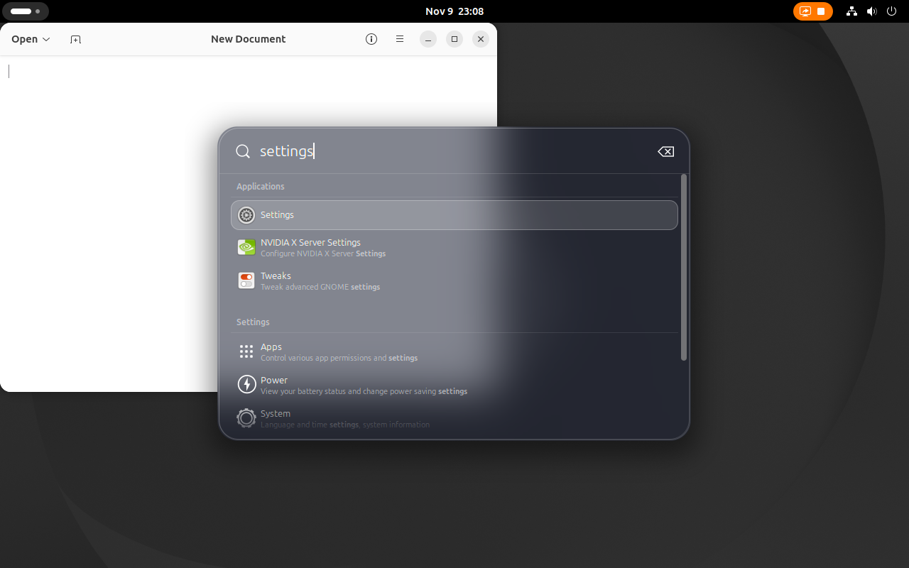
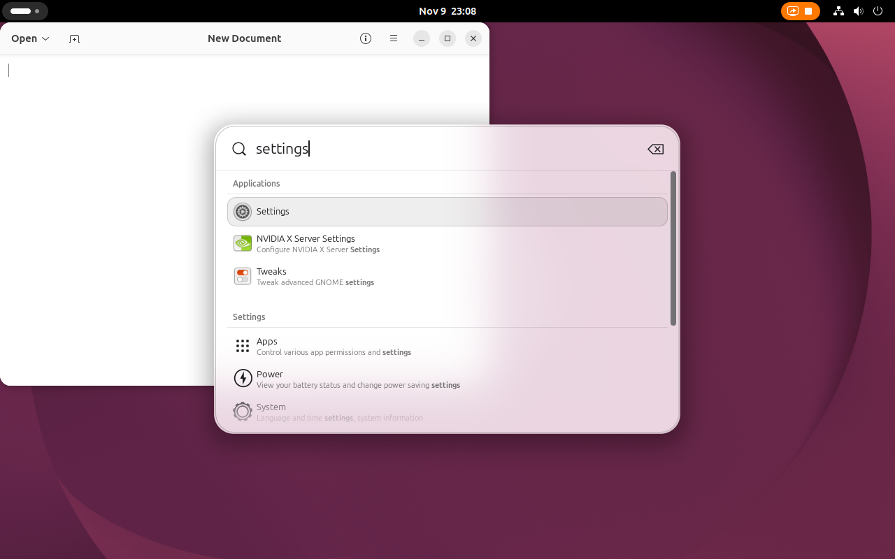

# Search Light Glass

A quick launcher-style search panel for GNOME Shell. Press a shortcut, type, and get apps, settings, files and more in a floating panel with a live blurred-glass background, instead of opening the Overview.

Search Light Glass is a fork of [Search Light](https://github.com/icedman/search-light) by [icedman](https://github.com/icedman). All of the underlying extension is icedman's work. The fork installs side by side with the original: it has its own extension UUID (`search-light-glass@antonioestela.github.com`), settings schema and stylesheet class, so the two do not share settings.

| Dark | Light |
| --- | --- |
|  |  |

The editor window sits partly behind the panel in both shots, which shows the blur.

## Features

- Real backdrop blur: the panel blurs whatever is behind it (wallpaper and windows), live, with rounded corners, saturation and a tint. No external tools are needed. On by default.
- A rounded outer shadow that is always present. In light mode there is a faint dark outline so the panel stays visible over white content.
- Automatic light and dark theme, following `org.gnome.desktop.interface color-scheme` and switching live. Colors you set yourself in the preferences override the theme.
- Single-column, sectioned results: section titles, 28px icons, the name over a grey subtitle, and a translucent selection pill. Applications are shown as rows like every other section. The stock Overview search is left untouched.
- New defaults: blur on, corner radius 28px, border 1px.
- Everything from Search Light: popup search box, colors, background and border customization, window effects, multi-monitor support, configurable shortcuts.

## Installation

From a clone of this repository:

```bash
$ git clone https://github.com/AntonioEstela/search-light-glass
$ cd search-light-glass
$ make install
```

Then log out and back in (on Wayland), and enable "Search Light Glass" in the Extensions app. `make publish` builds an installable zip.

## Keybinding

Ctrl+Super+Space by default; change it on the preferences page. Super is the Windows logo key.

## Known limitations

- Tested only on GNOME Shell 50.1. GNOME 48 and 49 are declared in `metadata.json` but are untested.
- App rows can't be dragged to the dock, because GNOME's dash only accepts its own app icons.
- Keyboard navigation of the result rows was verified by automated checks, but you should try it by hand.

## Development

- Unit tests: `gjs -m tests/unit/test_theme.js`.
- Nested GNOME Shell tests: `tests/nested/run.sh <scenario> [out_dir]` runs the working tree in a nested shell with a probe extension and checks the result. `tests/nested/run.sh all` runs every scenario.

## License and credits

Licensed under GPL-3.0, like the original. The original copyright stays; see `LICENSE`.

- [icedman](https://github.com/icedman) for [Search Light](https://github.com/icedman/search-light), the extension this is built on.
- [Blur my Shell](https://github.com/aunetx/blur-my-shell) for the background blurring approach.
